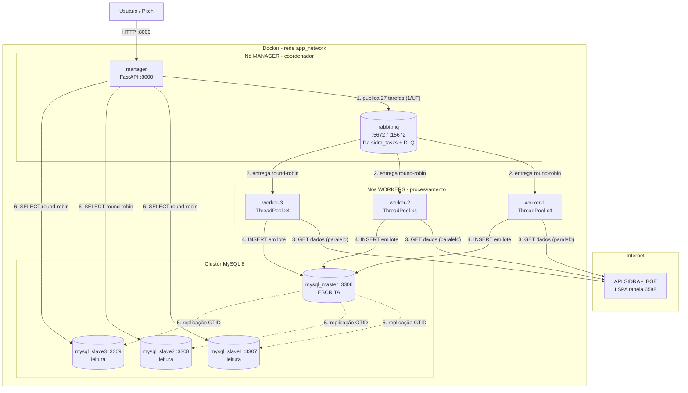
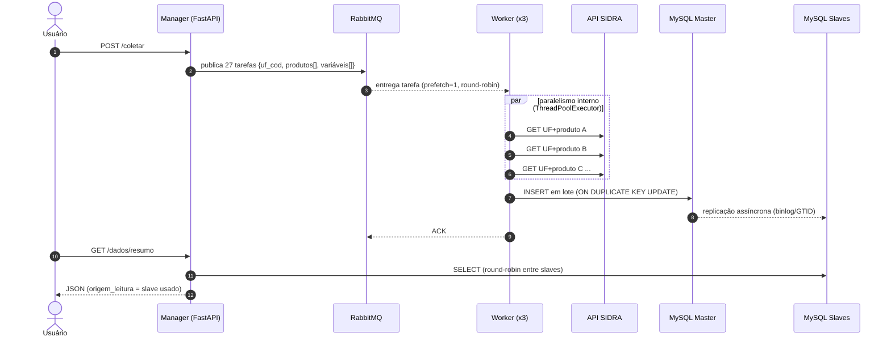
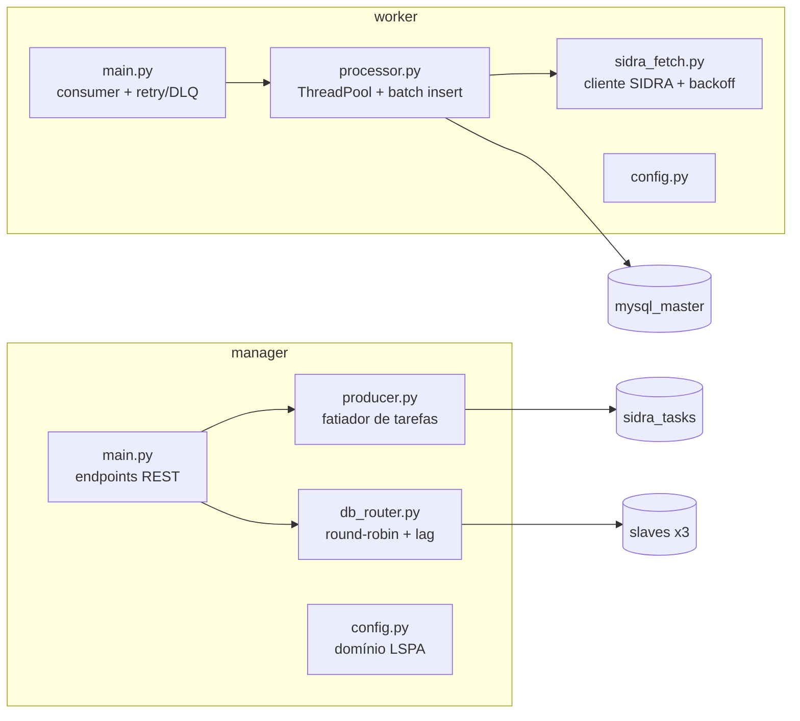

# Arquitetura de Solução — AgroData Distribuído

## 1. Visão geral e justificativa

O sistema consome dados públicos do agronegócio brasileiro via **API SIDRA/IBGE (LSPA — tabela 6588)**: produção, rendimento médio, área plantada e área colhida, por UF, produto e mês.

Decisões centrais de design:

1. **Topologia Manager/Workers com fila (RabbitMQ).** O coordenador nunca processa dados: ele fatia o trabalho e enfileira. Isso desacopla produção e consumo, absorve picos (a fila é durável) e permite escalar workers com `docker compose up -d --scale worker=N` sem alterar código.
2. **Paralelismo em dois níveis.** Entre nós: as 27 tarefas (uma por UF) são divididas entre os workers pelo próprio RabbitMQ (prefetch=1 → round-robin natural). Dentro de cada nó: os produtos da UF são buscados em paralelo com `ThreadPoolExecutor` (I/O-bound → threads são suficientes e baratas).
3. **Replicação Master-Slave MySQL (GTID + binlog ROW).** Uma única porta de escrita (consistência forte nas escritas) e três portas de leitura balanceadas em round-robin (escalabilidade de leitura, consistência eventual com lag tipicamente < 1s). Leituras fazem failover para o master se um slave cair.
4. **Dead Letter Queue.** Tarefas que falham duas vezes vão para a DLQ em vez de travar a fila — falhas ficam observáveis sem perder o restante do lote.

## 2. Diagrama de implantação (topologia distribuída)

## 3. Diagrama de sequência — fluxo de uma coleta

## 4. Diagrama de componentes

## 5. Tabela de decisões

| Decisão | Alternativa considerada | Por que a escolhida |
|---|---|---|
| RabbitMQ p/ distribuir tarefas | Manager chamar workers via HTTP | Fila durável absorve falhas e picos; workers são stateless e escaláveis |
| Threads no worker (`ThreadPoolExecutor`) | `multiprocessing` | Carga é I/O-bound (HTTP + SQL); threads têm menos overhead e o GIL não limita |
| 1 tarefa por UF (27 tarefas) | 1 tarefa por UF × produto (~270) | Menos mensagens, e a granularidade interna já é resolvida pelas threads |
| MySQL GTID + ROW binlog | Statement-based | ROW é mais seguro p/ replicação; GTID simplifica o setup (auto-position) |
| Leitura round-robin nos slaves | Sempre ler do master | Distribui carga e evidencia a topologia distribuída no pitch |
| Docker Compose | Docker Swarm | Compose deixa manager/workers explícitos e roda idêntico na máquina de qualquer membro do grupo |

## 6. Falhas e tolerância

- **Worker cai no meio da tarefa** → sem ACK, a mensagem volta para a fila e outro worker assume.
- **SIDRA fora do ar** → backoff (3 tentativas); falha persistente vai para a DLQ e é registrada em `coletas` com status `ERRO`.
- **Slave fora do ar** → o `db_router` tenta o próximo slave; se todos caírem, faz failover de leitura para o master.
- **RabbitMQ reinicia** → fila e mensagens são duráveis/persistentes; workers reconectam em loop.
